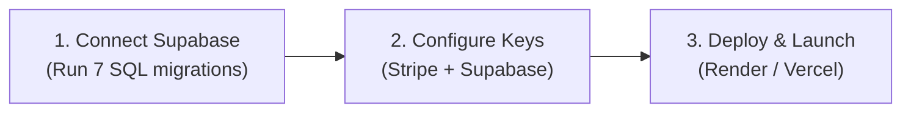

# 🤝 ServicePro OS — Commercial Buyer Handoff Guide

**Congratulations on acquiring ServicePro OS!** This document outlines everything you need to know to take full ownership, configure live credentials, and deploy your field service platform in under 30 minutes.

---

## 📋 System Architecture & Deliverables Summary

- **Framework:** Next.js 14 App Router, React 18, TypeScript (Strict Mode)
- **Styling & UI:** Tailwind CSS, Radix UI primitives, Lucide Icons, Mobile-first Progressive Web App (PWA)
- **Portals (5 Total):**
  1. **Public Marketing Website (26 pages):** SEO service pages, area locator, Instagram-style community reviews feed.
  2. **7-Step Online Booking Wizard:** Diagnosis intake, real-time slot selection, 10-minute hold concurrency locking, Stripe checkout.
  3. **Field Technician Mobile PWA (`/tech`):** Turn-by-turn GPS links, camera before/after photo uploads, touchscreen digital signatures, in-field parts/labor ledger, commission tracker.
  4. **Customer Self-Service Portal (`/account`):** Live appointment tracking, invoice ledger, multi-property address book, saved services.
  5. **Executive Admin Dashboard (`/admin`):** Drag-and-drop Kanban dispatch board, fleet locator, CRM, technician roster, revenue & CSV payroll reports.
- **Security Hardening (3-Layer Defense):**
  - Layer 1: Centralized Next.js middleware CSRF origin validation + sliding-window rate limiting.
  - Layer 2: Handler-level protection on checkout, payment recording, and uploads.
  - Layer 3: HttpOnly, SameSite=Strict cookies; anti-tamper header locks; zero client-side `document.cookie`.

---

## 🚀 15-Minute Turnkey Production Deployment



### Step 1: Database Provisioning (Supabase PostgreSQL)
1. Sign up or log in at [Supabase.com](https://supabase.com) and create a new project.
2. Open the **SQL Editor** in your Supabase dashboard.
3. Execute the 7 migrations located in [`supabase/migrations/`](supabase/migrations/) in numerical order:
   - `0001_extensions_enums.sql`
   - `0002_tables.sql`
   - `0003_indexes_triggers.sql`
   - `0004_functions.sql` (Advisory locks, slot capacity math, revenue aggregation)
   - `0005_rls.sql` (Row-Level Security for Owner, Technician, and Customer roles)
   - `0006_storage.sql` (Creates private bucket for field photos)
   - `0007_realtime.sql` (Enables live dispatch sync)

### Step 2: Live Payment Gateway (Stripe)
1. In your [Stripe Dashboard](https://dashboard.stripe.com), toggle **Live Mode**.
2. Retrieve your **Publishable Key** (`pk_live_...`) and **Secret Key** (`sk_live_...`).
3. Under **Developers → Webhooks**, add an endpoint pointing to:
   - `https://your-domain.com/api/stripe/webhook`
   - Listen for: `payment_intent.succeeded`, `payment_intent.payment_failed`, `charge.refunded`, `charge.dispute.created`.
   - Copy the signing secret (`whsec_...`).

### Step 3: Hosting Environment Variables
Paste these into your hosting platform (Vercel, Render, or Railway) or your `.env.production`:

```env
# Application URL
NEXT_PUBLIC_APP_URL=https://your-domain.com
NODE_ENV=production
NEXT_PUBLIC_API_MODE=real

# Supabase Credentials (from Project Settings -> API)
NEXT_PUBLIC_SUPABASE_URL=https://your-project.supabase.co
NEXT_PUBLIC_SUPABASE_ANON_KEY=your-supabase-anon-key
SUPABASE_SERVICE_ROLE_KEY=your-supabase-service-role-key

# Stripe Payment Gateway
NEXT_PUBLIC_STRIPE_PUBLISHABLE_KEY=pk_live_your_live_key
STRIPE_SECRET_KEY=sk_live_your_secret_key
STRIPE_WEBHOOK_SECRET=whsec_your_webhook_signing_secret

# SMS Notifications (Set to 'twilio' for live SMS, or 'console' for dev)
SMS_DRIVER=console
TWILIO_ACCOUNT_SID=AC_your_account_sid
TWILIO_AUTH_TOKEN=your_auth_token
TWILIO_FROM_NUMBER=+13055550100

# System Security
CRON_SECRET=generate_a_random_32_character_token_here
ALLOW_DEMO_AUTH=false
```

### Step 4: Seed Initial Administrator & Launch
Run these terminal commands:
```bash
pnpm install
pnpm sync-config      # Syncs business rules & pricing into the database
pnpm create-owner      # Bootstraps your administrator account
pnpm build
pnpm start
```

---

## ⚙️ Architecture & Operational Notes for the Owner

1. **White-Labeling:** You can change company name, phone number, operating hours, service catalog, and tax rates anytime in `config/business.config.ts`. Run `pnpm sync-config` to push changes to the live database.
2. **Demo Auth Toggle:** Setting `ALLOW_DEMO_AUTH=false` completely disables the demo authentication bypass endpoint in production.
3. **Rate Limiting:** Ships with a high-performance in-memory sliding-window limiter (20 req/min sensitive, 60 req/min general). If scaling across multiple container instances, Upstash Redis can be attached seamlessly.
4. **Offline Local Engine:** When running locally without internet or without Supabase, the system automatically uses a disk-persisted fallback (`LOCAL_DB_PATH`) so development and testing never stall.

---

## 📞 Support & Handover Verification

- TypeScript Typecheck: `pnpm typecheck` (0 errors)
- Automated Test Suite: `pnpm test` (112 tests passing across 10 suites)
- Production Build: `pnpm build` (clean compilation, zero chunking errors)
